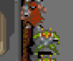
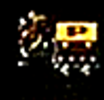
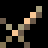
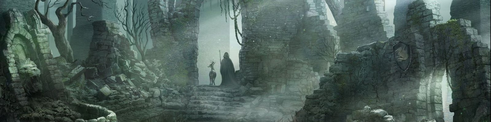

# Battlantis for MiSTer

**Version 2.0.3** (release `releases/Battlantis_20261018c.rbf`).

Konami's 1987 arcade shooter **Battlantis** (GX777 board), rebuilt from scratch for the MiSTer FPGA. Three versions in one core, scores that save, a sharp picture on a CRT, and an OSD you can understand at a glance.

## At a glance

| &nbsp;&nbsp;&nbsp;&nbsp;&nbsp;&nbsp;&nbsp;&nbsp;&nbsp;&nbsp;&nbsp;&nbsp;&nbsp;&nbsp;&nbsp;&nbsp;&nbsp;&nbsp; | | |
|:-:|---|---|
|  | **Game** | Clear every enemy off the screen to move on. 16 stages, and the Emperor Asmodeus waits at the end |
|  | **Versions** | World (G), version F and Japan (E), picked in the OSD |
|  | **Players** | 1 or 2, Can share a controller or each with their own controller |
|  | **High scores** | Load by themselves, save with one button, can be reset to the original table |
|  | **Picture** | HDMI (rotated for a normal TV) and analog CRT (rotated, sized and smoothed from the OSD) |
|  | **Cocktail table** | Real cocktail cabinet support: the picture flips for player 2 on the analog and digital output |
|  | **Sound** | Two YM3812 FM chips, mono or split stereo, a Treble option, volume per chip |

## How to play

*The arcade game's instruction card, translated into English by the author. Battlantis and the original card artwork are Konami's.*

| &nbsp;&nbsp;&nbsp;&nbsp;&nbsp;&nbsp;&nbsp;&nbsp;&nbsp;&nbsp;&nbsp;&nbsp;&nbsp;&nbsp;&nbsp;&nbsp;&nbsp;&nbsp; | | |
|:-:|---|---|
|  | **Move and shoot** | Move left, right, up and down, and shoot with one button |
|  | **Clear the screen** | Clear every enemy off the screen to finish the stage. If the enemies take over your castle wall, it is over |
|  | **Destroy the P-Box** | Shooting the P-Box gives you a power up. The Power-up Crests can be seen below. |
|  | **Lives** | Choose 2, 3, 5 or 7 lives with the Lives DIP switch (OSD, DIP Switches page). The factory setting is 3 lives |
|  | **Continue** | You can continue after losing all lives. The Continues DIP switch sets how many times you can: 5 (the factory setting) or 3 |

**Power items**

| &nbsp;&nbsp;&nbsp;&nbsp;&nbsp;&nbsp;&nbsp;&nbsp;&nbsp;&nbsp;&nbsp;&nbsp;&nbsp;&nbsp;&nbsp;&nbsp;&nbsp;&nbsp; | | |
|:-:|---|---|
|  | **Invisibility** | The player becomes invisible |
|  | **Bow-gun** | Destroys all enemies struck (the shot passes through) |
|  | **Nitro grenade** | A big explosion clears a wide area |
|  | **Stop clock** | Enemies freeze for several seconds |
|  | **Rapid fire** | Fire 4 shots instead of 2 |
|  | **Speed-up** | The player's speed increases |

## Install

| &nbsp;&nbsp;&nbsp;&nbsp;&nbsp;&nbsp;&nbsp;&nbsp;&nbsp;&nbsp;&nbsp;&nbsp;&nbsp;&nbsp;&nbsp;&nbsp;&nbsp;&nbsp; | | |
|:-:|---|---|
|  | **You need** | The MiSTer **SDRAM module** and your own legally obtained ROM set |
|  | **1. Core file** | Copy the core file (`Battlantis_20261018c.rbf`) to `/media/fat/_Arcade/cores/` |
|  | **2. MRA file** | Copy `Battlantis.mra` to `/media/fat/_Arcade/` |
|  | **3. ROM set** | Put `battlnts.zip` in `/media/fat/games/mame/`. It must also contain the files of the other two versions (folders `battlntsa` and `battlntsj`), as in the full MAME set |
|  | **4. Play** | Start **Battlantis** from the Arcade menu |

No ROM data is included in this repository.

## Controls

| &nbsp;&nbsp;&nbsp;&nbsp;&nbsp;&nbsp;&nbsp;&nbsp;&nbsp;&nbsp;&nbsp;&nbsp;&nbsp;&nbsp;&nbsp;&nbsp;&nbsp;&nbsp; | | |
|:-:|---|---|
|  | **Single controls (the default)** | One set of controls. One pad plays everything: with two players the game takes turns and you pass the pad. **Start 2** begins a two player game. The game only reads the first pad, so a second pad does nothing in this mode |
|  | **Dual controls** | Each player has their own controller: player 1 uses the first pad, player 2 the second. The game takes turns, so each pad is live on its player's turn. Use it for a cabinet with two sides, a cocktail table, or two pads on a couch |
|  | **How to switch** | **OSD > DIP Switches > Upright Controls**, Single or Dual. The game reads that switch only at start up, as the real board does, so the core restarts the game by itself when you change it. You do not need to reset anything. **Cocktail** cabinet always counts as Dual, so Upright Controls is greyed out while it is selected |
|  | **Which pad is which** | The first pad you press a button on becomes player 1 and the next one player 2 (the MiSTer decides that). The controls work out of the box with each pad's default layout. To change it, use **Define joystick buttons** (OSD, press Right for the System menu) and press the buttons it asks for on that pad. Each controller **model** keeps its own map (a PS4 and a PS5 pad are two models), and two pads of the same model share one. The **Controller Setup** page in the OSD lists these steps and follows the Single or Dual setting |

## The OSD at a glance

Open the OSD with the button on your controller or **F12** on a keyboard. The first choice of every option is the factory setting.

| &nbsp;&nbsp;&nbsp;&nbsp;&nbsp;&nbsp;&nbsp;&nbsp;&nbsp;&nbsp;&nbsp;&nbsp;&nbsp;&nbsp;&nbsp;&nbsp;&nbsp;&nbsp; | | |
|:-:|---|---|
|  | **Game Version** | Restarts the game when you change it |
|  | **Video** | Separate options for HDMI and for the analog CRT output. The CRT options do nothing on HDMI and the other way round |
|  | **CRT Size and Smoothing** | 182x208 is the default and the sharpest: every tile of the picture lands on a whole number of pixels. CRT Smoothing keeps the scaled picture even; turn it Off for plain pixels |
|  | **VGA Scaler** | Off by default. When On, the analog port carries the HDMI picture (the rotated, sized and smoothed one) instead of the raw 15 kHz raster, so a VGA or other 31 kHz monitor works. Leave it Off for a 15 kHz CRT. It is the same switch as `vga_scaler=1` in `MiSTer.ini` |
|  | **Treble** | Under Sound Settings. Softens the FM chips for listeners who find them harsh. Original is the unfiltered sound |
|  | **Service Mode** | Restarts the game when toggled, because the game only reads that switch at start up. Leave it Off for normal play |
|  | **Cocktail Cabinet and Upright Cabinet Controls** | Both restart the game when you change them, for the same reason. **Cocktail** always counts as Dual controls, so Upright Controls is greyed out while Cocktail is selected |
|  | **Controller Setup** | A page that tells you the steps to set up your pad (or two pads), and follows the Single or Dual setting |

## High scores

| &nbsp;&nbsp;&nbsp;&nbsp;&nbsp;&nbsp;&nbsp;&nbsp;&nbsp;&nbsp;&nbsp;&nbsp;&nbsp;&nbsp;&nbsp;&nbsp;&nbsp;&nbsp; | | |
|:-:|---|---|
|  | **Restored for you** | Saved scores are put back a few seconds after the core loads, and again after an OSD **Reset** |
|  | **Save High Scores** | Writes the current top 10 to `/media/fat/config/nvram/Battlantis.nvm`. Nothing saves on its own, so you decide which scores are worth keeping |
|  | **Clear High Scores** | Asks "Are you sure you want to clear your hi scores? They will be lost forever." **Yes** puts the original top 10 back (and saves it). Either answer returns you to the main menu |
|  | **A real score** | The saved table is the game's own top 10, earned by playing it. There are no cheats in this build |

## Cabinet setups

| &nbsp;&nbsp;&nbsp;&nbsp;&nbsp;&nbsp;&nbsp;&nbsp;&nbsp;&nbsp;&nbsp;&nbsp;&nbsp;&nbsp;&nbsp;&nbsp;&nbsp;&nbsp; | | |
|:-:|---|---|
|  | **A normal upright setup** | Cabinet **Upright**, Upright Controls **Single**. One set of controls, as on the factory default |
|  | **Two controllers, side by side** | Upright Controls **Dual** (the game restarts by itself). Each player uses their own controller on their own turn |
|  | **A cocktail table** | Cabinet **Cocktail**, nothing else to set: Dual controls come with it. The game restarts by itself. On the analog output the picture flips for player 2, as the board does. HDMI is never flipped by it |

Konami's board has cocktail table support built into the game, so this is the real behaviour of the hardware, not an add-on.

## Picture on HDMI and on a CRT

| &nbsp;&nbsp;&nbsp;&nbsp;&nbsp;&nbsp;&nbsp;&nbsp;&nbsp;&nbsp;&nbsp;&nbsp;&nbsp;&nbsp;&nbsp;&nbsp;&nbsp;&nbsp; | | HDMI | Analog CRT |
|:-:|---|---|---|
|  | **Orientation** | HDMI Orientation | CRT Orientation (Vertical raw, or Horizontal rotated) |
|  | **Flip** | Flip Monitor | CRT Flip |
|  | **Size and shape** | Aspect ratio | CRT Size and CRT Aspect |
|  | **Smoothing** | The MiSTer scaler | CRT Smoothing |
|  | **Position** | Not needed | CRT V Position and CRT H Position |

## Credits

| &nbsp;&nbsp;&nbsp;&nbsp;&nbsp;&nbsp;&nbsp;&nbsp;&nbsp;&nbsp;&nbsp;&nbsp;&nbsp;&nbsp;&nbsp;&nbsp;&nbsp;&nbsp; | | |
|:-:|---|---|
|  | **Roger Taylor** | [Nitrobotics/hd6309](https://github.com/Nitrobotics/hd6309), the Hitachi HD6309 native mode CPU core the main program needs |
|  | **Jose Tejada (jotego)** | The `jtopl` (YM3812 / OPL2) core from the [JTCORES](https://github.com/jotego/jtcores) project, GPL 3, used for both FM chips. His other cores and documentation were also a constant reference |
|  | **Daniel Wallner and the T80 contributors** | The T80 Z80 core used for the sound CPU |
|  | **Sorgelig and the MiSTer FPGA project** | The platform framework (`sys/`, `hps_io`, `arcade_video`) and the SDRAM controller this core's `sdram.sv` is built on |
|  | **The MAME project** | `battlnts.cpp`, `k007342.cpp`, `k007420.cpp` and `konamipt.h` (mamedev.org) were the authoritative reference for the ROM layout, the chip behaviour and the draw order |
|  | **Konami** | The original 1987 arcade hardware and games. All game assets and ROM content remain Konami's property |

This core was developed with substantial assistance from **Claude** (Anthropic's AI assistant) and, earlier in the project, Google's **Gemini**, for RTL implementation, cross checking against the MAME driver and the schematics of related Konami boards, simulation and debugging. The direction, the testing on a real MiSTer, every decision about what was acceptable and the final judgement of what works were the author's.

The code is released under the GNU General Public License (see `LICENSE` and the header of each file; the `jt*` cores are GPL 3).
