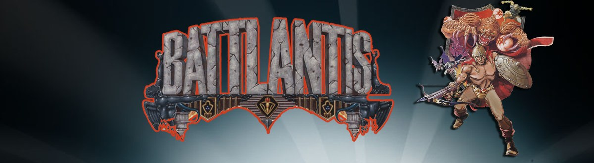

# Battlantis for MiSTer

**Version 2.0.1** (release `releases/Battlantis_20261018.rbf`).

Konami's 1987 arcade shooter **Battlantis** (GX777 board), rebuilt from scratch for the MiSTer FPGA. Three versions in one core, scores that save, a sharp picture on a CRT, and an OSD you can understand at a glance.

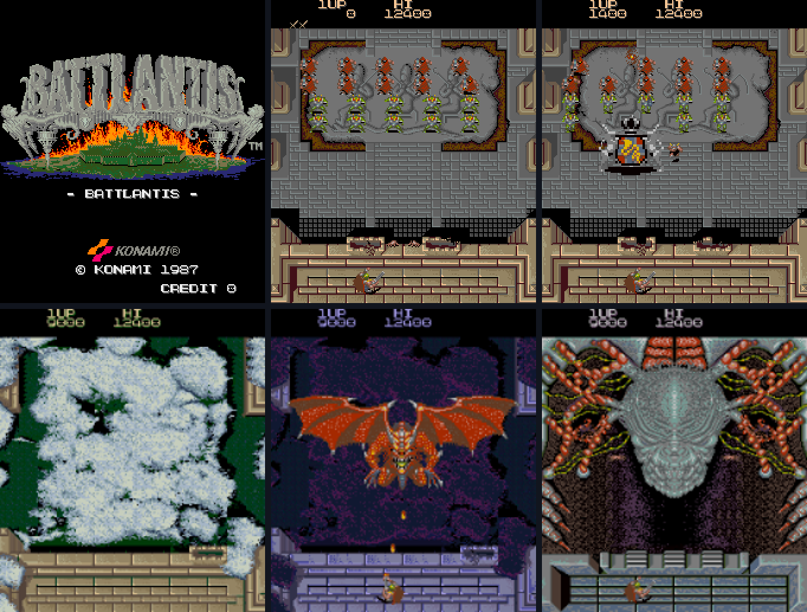

## At a glance

| | | |
|:-:|---|---|
| 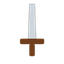 | **Game** | Clear every enemy off the screen to move on. 16 stages, and the Emperor Asmodeus waits at the end |
|  | **Versions** | World (G), version F and Japan (E), picked in the OSD |
|  | **Players** | 1 or 2, each with their own controller |
|  | **High scores** | Load by themselves, save with one button, can be reset to the original table |
|  | **Picture** | HDMI (rotated for a normal TV) and analog CRT (rotated, sized and smoothed from the OSD) |
|  | **Cocktail table** | Real cocktail cabinet support: the picture flips for player 2 on the analog output |
|  | **Sound** | Two YM3812 FM chips, mono or split stereo, a Treble option, volume per chip |

## How to play

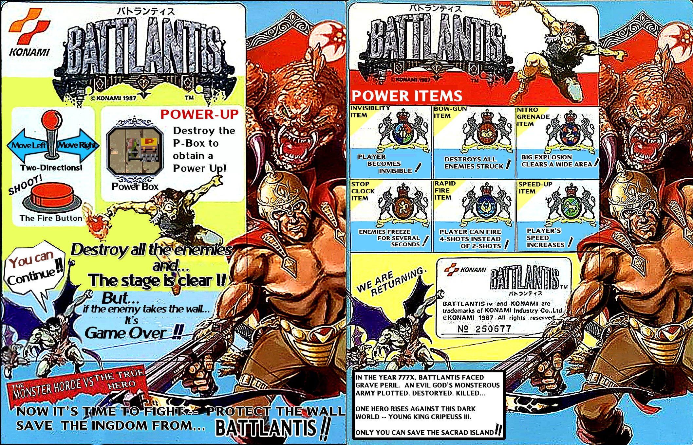

*The arcade game's instruction card, translated into English by the author. Battlantis and the original card artwork are Konami's.*

| | | |
|:-:|---|---|
|  | **Move and shoot** | Move left, right, up and down, and shoot with one button |
|  | **Clear the screen** | Clear every enemy off the screen to finish the stage. If the enemies take over your castle wall, it is over |
|  | **Destroy the P-Box** | Shooting the P-Cart gives you a power up. The Power-up Crests can be seen below. |
|  | **Continue** | You can continue after losing all lives. The number of continues is a DIP switch option |

**Power items**

| | | |
|:-:|---|---|
|  | **Invisibility** | The player becomes invisible |
|  | **Bow-gun** | Destroys all enemies struck (the shot passes through) |
|  | **Nitro grenade** | A big explosion clears a wide area |
|  | **Stop clock** | Enemies freeze for several seconds |
|  | **Rapid fire** | Fire 4 shots instead of 2 |
|  | **Speed-up** | The player's speed increases |

## Install

| | | |
|:-:|---|---|
|  | **You need** | The MiSTer **SDRAM module** and your own legally obtained ROM set |
|  | **1. Core file** | Copy the core file (`Battlantis_20261018.rbf`) to `/media/fat/_Arcade/cores/` |
|  | **2. MRA file** | Copy `Battlantis.mra` to `/media/fat/_Arcade/` |
|  | **3. ROM set** | Put `battlnts.zip` in `/media/fat/games/mame/`. It must also contain the files of the other two versions (folders `battlntsa` and `battlntsj`), as in the full MAME set |
|  | **4. Play** | Start **Battlantis** from the Arcade menu |

No ROM data is included in this repository.

## Controls

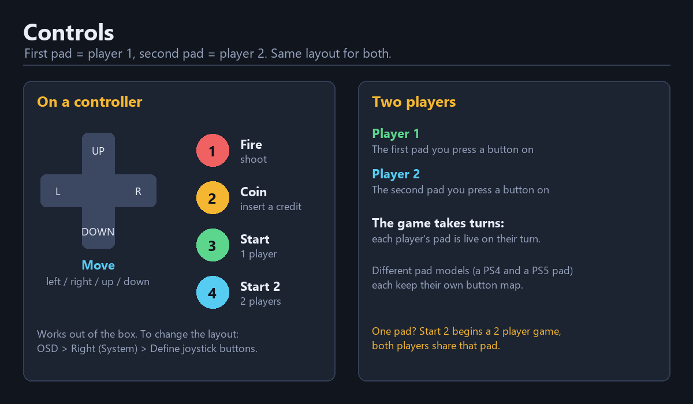

| | | |
|:-:|---|---|
|  | **Two players** | Player 1 uses the first controller, player 2 the second. The first pad you press a button on becomes player 1 and the next one player 2 (the MiSTer decides that). The controls work out of the box with each pad's default layout. To change it, use **Define joystick buttons** (OSD, press Right for the System menu) and press the buttons it asks for on that pad. Each controller **model** keeps its own map (a PS4 and a PS5 pad are two models), and two pads of the same model share one. The game takes turns, so each player's pad is live on that player's turn. The **Controller Setup** page in the OSD lists these steps |
|  | **One pad** | **Start 2** begins a two player game, but both players then share that pad |

## The OSD at a glance

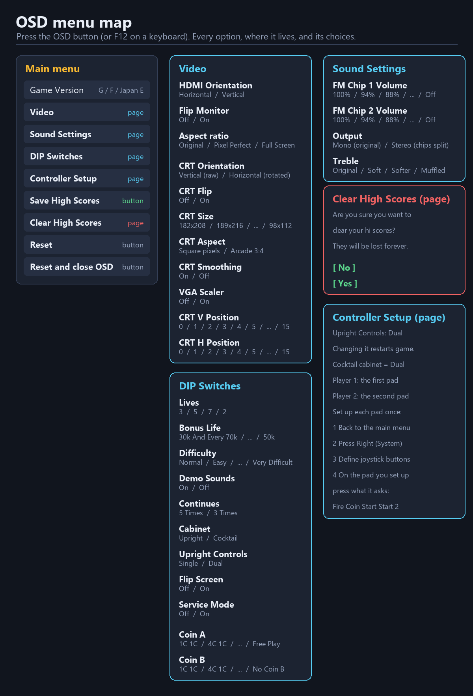

Open the OSD with the button on your controller or **F12** on a keyboard. The first choice of every option is the factory setting.

| | | |
|:-:|---|---|
|  | **Game Version** | Restarts the game when you change it |
|  | **Video** | Separate options for HDMI and for the analog CRT output. The CRT options do nothing on HDMI and the other way round |
| 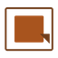 | **CRT Size and Smoothing** | 182x208 is the default and the sharpest: every tile of the picture lands on a whole number of pixels. CRT Smoothing keeps the scaled picture even; turn it Off for plain pixels |
|  | **Treble** | Under Sound Settings. Softens the FM chips for listeners who find them harsh. Original is the unfiltered sound |
|  | **Service Mode** | Restarts the game when toggled, because the game only reads that switch at start up. Leave it Off for normal play |
|  | **Cabinet and Upright Controls** | Both restart the game when you change them, for the same reason. **Cocktail** always counts as Dual controls, so Upright Controls is greyed out while Cocktail is selected |
|  | **Controller Setup** | A page that tells you the steps to set up your pad (or two pads), and follows the Single or Dual setting |

## High scores

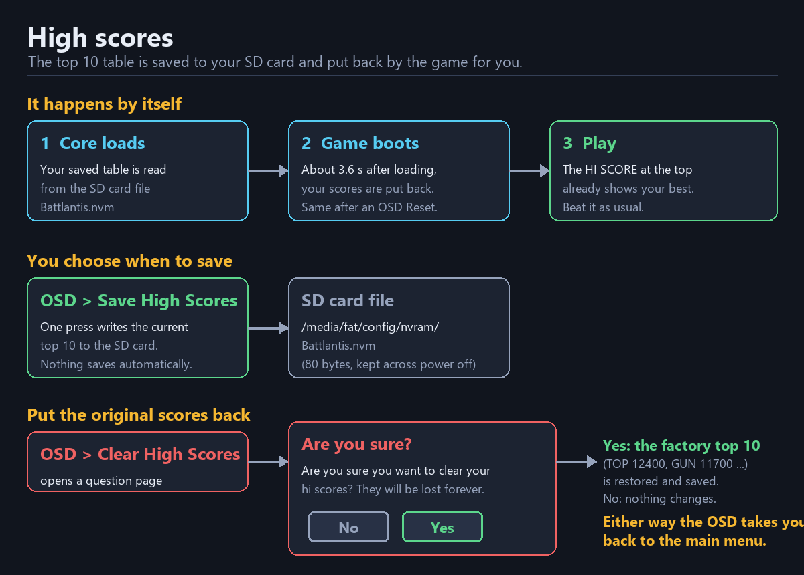

| | | |
|:-:|---|---|
|  | **Restored for you** | Saved scores are put back a few seconds after the core loads, and again after an OSD **Reset** |
|  | **Save High Scores** | Writes the current top 10 to `/media/fat/config/nvram/Battlantis.nvm`. Nothing saves on its own, so you decide which scores are worth keeping |
|  | **Clear High Scores** | Asks "Are you sure you want to clear your hi scores? They will be lost forever." **Yes** puts the original top 10 back (and saves it). Either answer returns you to the main menu |
|  | **A real score** | The saved table is the game's own top 10, earned by playing it. There are no cheats in this build |

## Cabinet setups

| | | |
|:-:|---|---|
|  | **A normal upright setup** | Cabinet **Upright**, Upright Controls **Single**. One set of controls, as on the factory default |
|  | **Two controllers, side by side** | Upright Controls **Dual** (the game restarts by itself). Each player uses their own controller on their own turn |
|  | **A cocktail table** | Cabinet **Cocktail**, nothing else to set: Dual controls come with it. The game restarts by itself. On the analog output the picture flips for player 2, as the board does. HDMI is never flipped by it |

Konami's board has cocktail table support built into the game, so this is the real behaviour of the hardware, not an add-on.

## Picture on HDMI and on a CRT

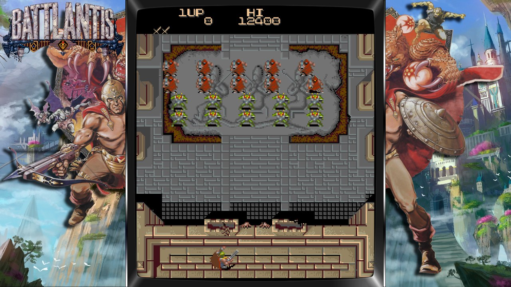

| | | HDMI | Analog CRT |
|:-:|---|---|---|
|  | **Orientation** | HDMI Orientation | CRT Orientation (Vertical raw, or Horizontal rotated) |
|  | **Flip** | Flip Monitor | CRT Flip |
| 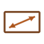 | **Size and shape** | Aspect ratio | CRT Size and CRT Aspect (Square pixels is right for this game) |
|  | **Smoothing** | The MiSTer scaler | CRT Smoothing |
| 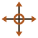 | **Position** | Not needed | CRT V Position and CRT H Position |

## Credits

| | | |
|:-:|---|---|
|  | **Roger Taylor** | [Nitrobotics/hd6309](https://github.com/Nitrobotics/hd6309), the Hitachi HD6309 native mode CPU core the main program needs |
|  | **Jose Tejada (jotego)** | The `jtopl` (YM3812 / OPL2) core from the [JTCORES](https://github.com/jotego/jtcores) project, GPL 3, used for both FM chips. His other cores and documentation were also a constant reference |
|  | **Daniel Wallner and the T80 contributors** | The T80 Z80 core used for the sound CPU |
|  | **Sorgelig and the MiSTer FPGA project** | The platform framework (`sys/`, `hps_io`, `arcade_video`) and the SDRAM controller this core's `sdram.sv` is built on |
|  | **The MAME project** | `battlnts.cpp`, `k007342.cpp`, `k007420.cpp` and `konamipt.h` (mamedev.org) were the authoritative reference for the ROM layout, the chip behaviour and the draw order |
|  | **Konami** | The original 1987 arcade hardware and games. All game assets and ROM content remain Konami's property |
|  | **The same author** | The Rack 'Em Up / The Hustler and Blades of Steel cores, whose chip implementations this core shares |

This core was developed with substantial assistance from **Claude** (Anthropic's AI assistant) and, earlier in the project, Google's **Gemini**, for RTL implementation, cross checking against the MAME driver and the schematics, simulation and debugging. The direction, the testing on a real MiSTer, every decision about what was acceptable and the final judgement of what works were the author's.

The code is released under the GNU General Public License (see `LICENSE` and the header of each file; the `jt*` cores are GPL 3).
